# VexorionERP Architecture and Workflow Diagrams

This document describes the implemented VexorionERP architecture as of 21 October 2026. The diagrams use Mermaid so they render in GitHub and can be imported or recreated in Notion.

## Diagram legend

- Solid arrows represent runtime calls or data flow.
- Dashed arrows represent deployment, configuration, or observability flow.
- Cylinders represent persistent storage.
- Cloudflare Pages hosts static frontend assets; business APIs run in Google Cloud Run.
- Cloudflare R2 stores objects, while Neon PostgreSQL stores application records and object metadata.

## 1. Production system context

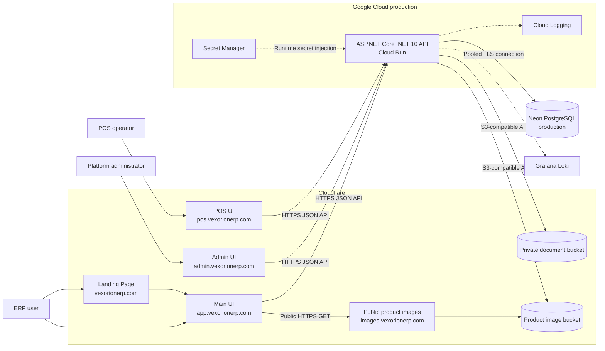

The API currently uses its Google-managed `run.app` hostname. A separate custom API hostname has not been introduced.

## 2. Repository and application layers

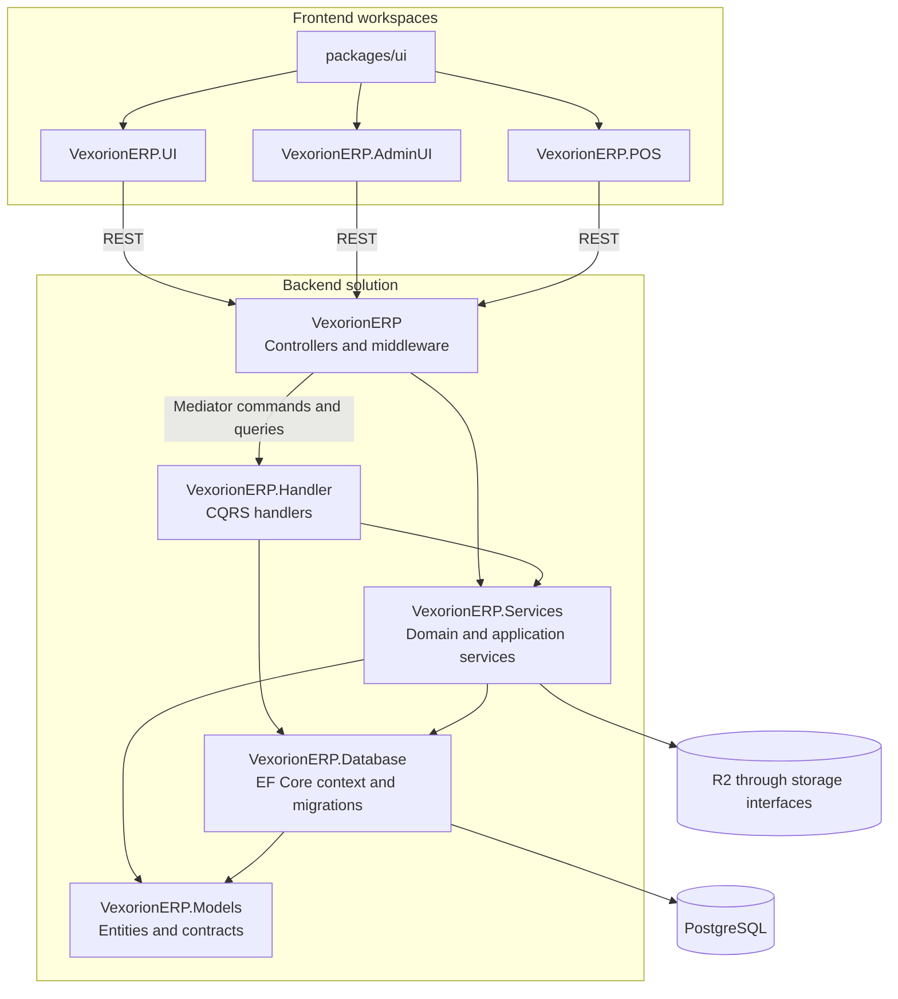

Controllers translate HTTP requests into application calls and return the shared API result/error contract. Business rules stay in handlers and services; persistence stays behind EF Core and storage abstractions.

## 3. Authenticated API request flow

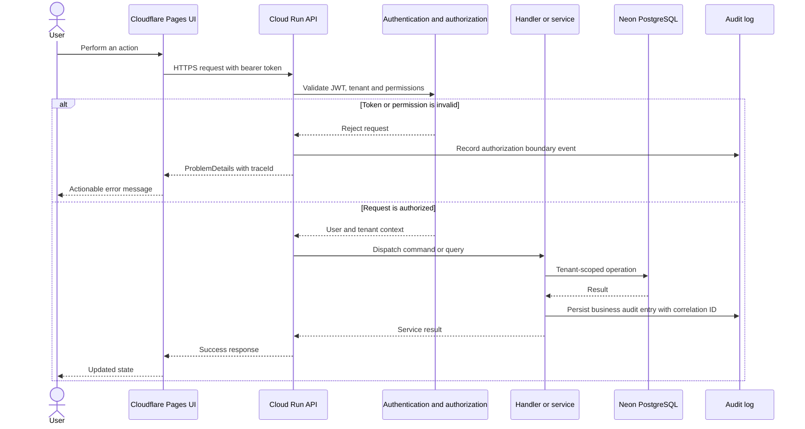

The HTTP `traceId` and persisted audit correlation ID allow an operator to connect an error response with application logs and audit history.

## 4. Tenant-isolation model

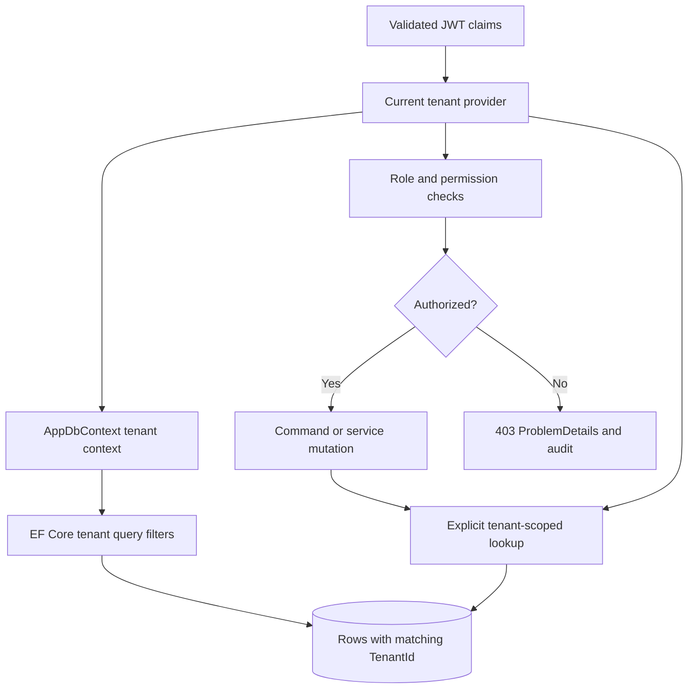

Tenant isolation is enforced in both authorization and data access. Cross-tenant identifiers must not bypass the current tenant context, even when the identifier itself is valid.

## 5. Project-document upload and download

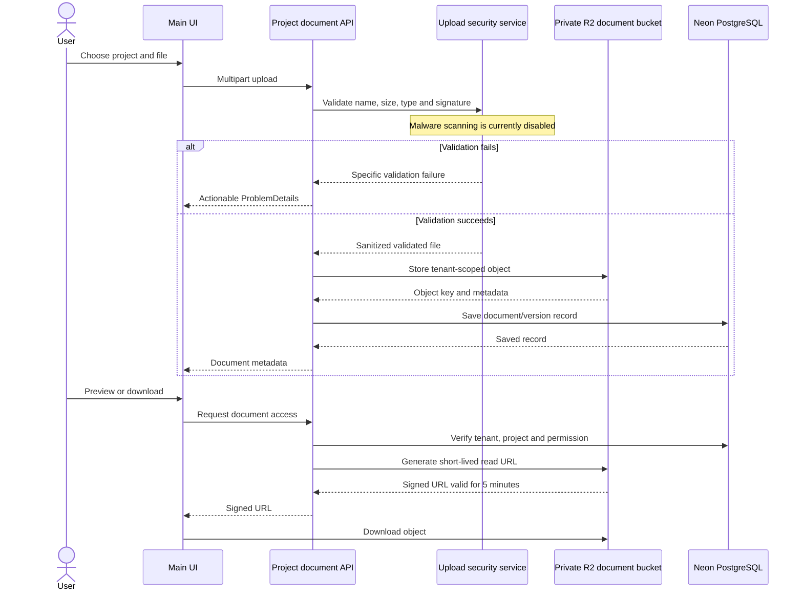

Private document access is authorized before a signed URL is issued. The URL is read-only and short-lived.

## 6. Storage deletion consistency

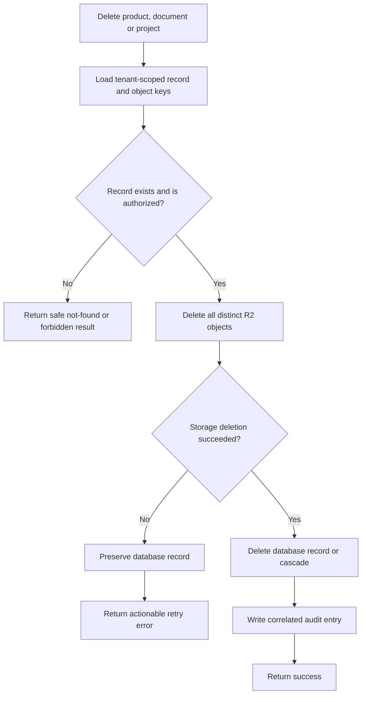

Storage is deleted before the database record. If R2 cleanup fails, the record remains so the operation can be retried instead of silently orphaning an object.

## 7. Database migration, bootstrap, and runtime separation

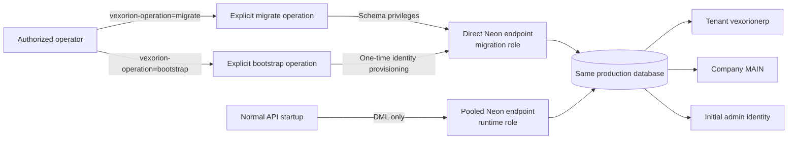

Normal startup cannot apply migrations or bootstrap data. The runtime role can use application tables but cannot create database or schema objects.

## 8. Backend CI/CD workflow

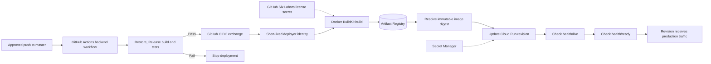

GitHub does not hold a Google service-account key or runtime database/storage secrets. Cloud Run obtains runtime secrets directly from Secret Manager.

## 9. Frontend CI/CD and affected-build workflow

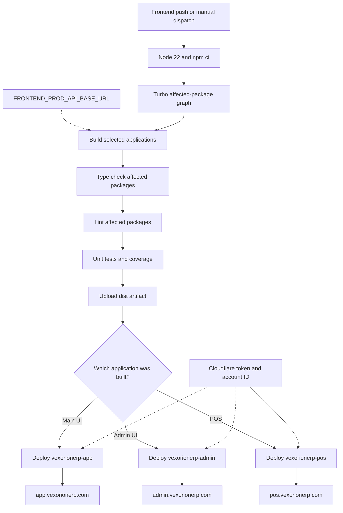

A shared-package or lockfile change can rebuild all consumers. A manual run with `deploy_all=true` rebuilds every frontend, which is required after changing a build-time API URL.

## 10. Secrets and configuration boundaries

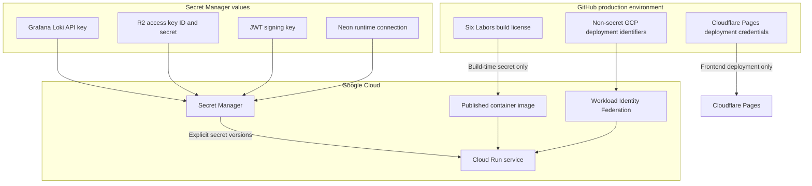

Non-secret R2 bucket identifiers and Loki endpoint/user values are Cloud Run environment variables. Sensitive runtime values are not duplicated in GitHub.

## 11. Observability and error correlation

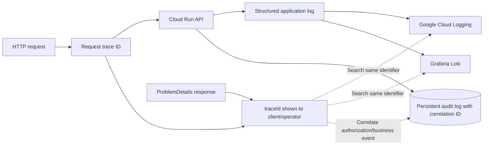

Health endpoints serve different purposes: `/health/live` confirms that the process is alive, while `/health/ready` confirms that the application is ready to receive traffic.

## Related operational guides

- [Neon PostgreSQL production setup](NEON_PRODUCTION_SETUP.md)
- [Google Cloud Run production setup](GOOGLE_CLOUD_RUN_PRODUCTION_SETUP.md)
- [Cloudflare R2 production setup](CLOUDFLARE_R2_SETUP.md)
- [Cloudflare Pages setup for the three UIs](CLOUDFLARE_PAGES_UI_SETUP.md)
- [Migration and development plan](VEXORIONERP_AZURE_MIGRATION_PLAN.md)

