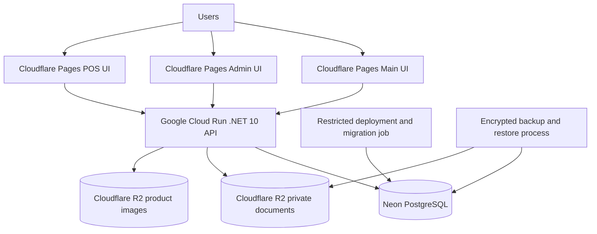

# VexorionERP — Low-Cost Azure Exit and Clean Deployment Plan

**Version:** 2.0

**Date:** 2026-10-20

**Status:** Reviewed implementation plan; no production deployment authorized

**Priority:** Data integrity, security, and recoverability before minimum infrastructure cost

## 1. Confirmed scope and decisions

VexorionERP will be deployed as a new environment rather than by transferring the current Azure database or Azure Blob contents.

Confirmed decisions:

- The three frontend applications remain on Cloudflare Pages:
  - `https://app.vexorionerp.com`
  - `https://admin.vexorionerp.com`
  - `https://pos.vexorionerp.com`
- The backend remains an ASP.NET Core Web API using PostgreSQL.
- The new database starts empty except for one bootstrap tenant with code `vexorionerp`, its initial company, required roles and permissions, and one superadmin account.
- No Azure PostgreSQL records or Azure Blob objects are copied as part of this plan.
- Real customer data may be entered only after the new environment passes the readiness gates in this document.
- The backend is upgraded from .NET 8 to .NET 10 before provider-specific migration work begins.
- ClamAV remains disabled until a private scanner is provisioned and integration-tested.
- Azure resources are not deleted by this plan. Any later retirement requires separate inventory, retention, and owner approval.

Non-goals:

- Rewriting the frontend applications.
- Replacing PostgreSQL with another database engine.
- Adding microservices or unrelated product features.
- Importing historical Azure data.
- Enabling unvalidated production secrets or placeholder credentials.
- Promising that production will remain permanently free.

## 2. Recommended target architecture



### 2.1 Primary provider choice

- **API:** Google Cloud Run, request-based billing, `min-instances=0`, initially `max-instances=1`.
- **Database:** Neon PostgreSQL Free initially, with pooled runtime access and a direct/admin connection for controlled migrations.
- **Object storage:** Cloudflare R2 Standard.
- **Frontend:** existing Cloudflare Pages deployments.
- **Initial API hostname:** the Cloud Run `*.run.app` hostname, unless a separate custom-domain decision is approved.

This stack can cost approximately USD 0 for a low-traffic pilot that remains within every provider allowance. Zero cost is a target, not a service guarantee.

### 2.2 Cost boundaries

| Component | Initial target | Free-boundary risk |
|---|---:|---|
| Cloudflare Pages | USD 0 | Existing account limits still apply. |
| Cloud Run API | USD 0 | Jakarta regional pricing, requests, CPU, memory, outbound transfer, builds, and supporting services can create charges. |
| Neon PostgreSQL | USD 0 | Free storage, compute, connection, transfer, restore-window, and branch limits apply; no paid-tier SLA is assumed. |
| Cloudflare R2 | USD 0 | Standard storage and operation allowances apply; use limits and billing must be monitored. |
| Artifact Registry | Approximately USD 0 | Retain only required image versions so registry storage remains small. |
| Secret management | Approximately USD 0 | Keep active secret versions and access operations within the provider allowance. |
| Backups | Prefer USD 0 initially | Never omit backups merely to keep the bill at zero. Upgrade when reliable backup requirements exceed free limits. |
| Custom API domain | Deferred | Google-recommended load balancing can add fixed cost; direct Cloud Run domain mapping is not assumed production-ready. |

Reserve an owner-approved contingency budget of USD 5–20/month before onboarding irreplaceable customer data. Budgets and alerts are notifications, not guaranteed hard caps.

### 2.3 Alternatives not selected initially

An Oracle Always Free A1 VM can host the API, but it introduces operating-system patching, firewall, certificate, monitoring, capacity, ARM compatibility, and idle-reclamation concerns. It is retained as a fallback experiment, not the preferred real-data pilot platform.

Self-hosting PostgreSQL on a free VM is not approved for real customer data because it creates a single failure domain and materially increases backup and recovery responsibility.

## 3. Repository facts already confirmed

- Nine backend projects currently target `net8.0`.
- The local environment has .NET SDK 10 available.
- The application uses EF Core and `Npgsql.EntityFrameworkCore.PostgreSQL`.
- PostgreSQL migration `20261018155036_AddProjectDocumentTrigramSearchIndexes` requires the `pg_trgm` extension.
- The runtime connection key is `ConnectionStrings__DefaultConnection`.
- The API currently calls `Database.MigrateAsync()` during application startup.
- Startup also reconciles roles and permissions, optionally creates a bootstrap tenant, and backfills tenant governance defaults.
- Document storage already uses `IDocumentStorageService`.
- Product images use the separate `IProductImageStorageService` and currently expect stable image and thumbnail URLs.
- Document storage persists provider-neutral object paths for project documents and generated documents, while product entities persist image URLs.
- ClamAV support is implemented but disabled by default.
- No `IHostedService` or `BackgroundService` implementation was found; startup initialization is nevertheless state-changing and must be separated from normal API startup.
- There is no backend Dockerfile in the current repository.
- This document lives at `docs/VEXORIONERP_AZURE_MIGRATION_PLAN.md`; generated migration evidence belongs under `docs/migration/`.

## 4. Mandatory implementation sequence

The phases below must be completed in order. Provider migration work must not be mixed into the .NET 10 upgrade.

### NET10-M01 — Upgrade the backend to .NET 10

Scope:

1. Change all nine backend projects from `net8.0` to `net10.0`.
2. Upgrade the coordinated Microsoft ASP.NET Core, EF Core, Identity, and test packages to compatible 10.0 patch versions.
3. Upgrade `Npgsql.EntityFrameworkCore.PostgreSQL` and Npgsql to compatible 10.x versions.
4. Review Npgsql 10 breaking changes, particularly SQL translation and query-plan changes.
5. Review source generators and libraries with native/runtime sensitivity, including Mediator, QuestPDF, ClosedXML, Open XML, ImageSharp, and Azure SDK packages.
6. Pin the intended .NET SDK using `global.json` if the repository does not already do so.
7. Keep the existing migrations intact; do not regenerate old migrations.
8. Generate an idempotent migration script or model-difference evidence proving that the framework upgrade did not introduce unintended schema changes.

Acceptance:

- `dotnet restore` succeeds without unsupported-package warnings.
- Release build succeeds with zero warnings.
- The complete backend test suite passes.
- NuGet direct and transitive vulnerability audit is clean.
- Existing PostgreSQL integration and query-plan-sensitive tests pass.
- No provider migration, DNS change, or production secret change occurs in this milestone.

Rollback: revert only the .NET/package upgrade commit; no database or infrastructure state should have changed.

### MIG-M00 — Make initialization production-safe

The API must not automatically modify schema or bootstrap data whenever a Cloud Run instance starts.

Implement separate, explicit operations for:

- Applying EF migrations with a privileged direct database connection.
- Reconciling roles and permission claims.
- Creating the initial tenant, company, and superadmin.
- Applying tenant governance defaults.

Normal API startup must:

- Validate configuration.
- Open no schema-changing transaction.
- Avoid creating or updating roles, tenants, users, or defaults.
- Fail clearly when the schema is missing or incompatible.

Bootstrap requirements:

- Tenant code: `vexorionerp`.
- Bootstrap password comes only from a managed secret and is never logged.
- Bootstrap operation is idempotent but refuses conflicting existing identities.
- Bootstrap is disabled immediately after the one-time operation succeeds.
- Production startup must reject known placeholder JWT, bootstrap, database, and storage credentials.

Acceptance:

- Concurrent API starts do not execute schema or seed writes.
- A new empty test database can be provisioned deterministically through the explicit migration/bootstrap operation.
- Re-running the provisioning operation makes no duplicate tenant, user, role, or claim records.
- Provisioning tests cover partial failure and safe retry.

### MIG-M01 — Adapt storage for Cloudflare R2

Reuse the existing application abstractions:

- `IDocumentStorageService`
- `IProductImageStorageService`

Do not introduce a competing `IDocumentStorage` abstraction unless a reviewed contract limitation requires it.

#### Private document storage

Implement an R2-backed `IDocumentStorageService` with:

- Tenant-scoped safe object keys.
- Upload, signed download URL, server-side download, and idempotent delete behavior matching the existing contract.
- Canonical content type, safe attachment filename, size, and SHA-256 behavior.
- Short-lived read-only presigned URLs issued only after application authorization.
- A private Standard bucket with a least-privilege bucket-scoped token.
- Mocked unit tests plus an optional credential-gated real-bucket integration suite.

#### Product-image storage

Implement an R2-backed `IProductImageStorageService` separately. Before implementation, approve one delivery policy:

1. Public, non-sensitive product images through a dedicated R2 custom domain; or
2. Private images with an API/signed delivery contract and corresponding frontend/model changes.

Do not place private documents and public product images in the same bucket policy. Do not persist an unusable private S3 endpoint as a product image URL.

#### Provider selection

Use typed configuration and dependency injection, for example:

```text
Storage__Provider=R2
Storage__R2__AccountId=<nonsecret>
Storage__R2__DocumentBucketName=<nonsecret>
Storage__R2__ProductImageBucketName=<nonsecret>
Storage__R2__AccessKeyId=<secret>
Storage__R2__SecretAccessKey=<secret>
Storage__R2__SignedUrlLifetimeMinutes=5
```

No Azure-to-R2 transfer utility is required for the clean deployment.

### MIG-M02 — Provision Neon from an empty database

1. Create separate staging and production Neon projects or databases.
2. Record the actual PostgreSQL versions, regions, free-plan limits, pooled connection limits, direct connection limits, and restore window.
3. Confirm `pg_trgm` is available and can be created by the migration role.
4. Create a privileged migration role and a least-privilege runtime role where supported.
5. Apply all existing EF migrations to an empty staging database through the explicit migration operation.
6. Run schema, index, constraint, and extension verification.
7. Run the bootstrap operation for the `vexorionerp` tenant using a temporary secret.
8. Disable bootstrap and rotate or destroy the temporary bootstrap credential.
9. Exercise a backup and restore into an isolated database.
10. Repeat the reviewed process for the empty production database only after staging passes.

Runtime configuration:

```text
ConnectionStrings__DefaultConnection=<pooled TLS connection secret>
```

Migration configuration must use the provider-recommended direct endpoint. Do not use `Trust Server Certificate=true` to suppress certificate failures.

Tune pool size against the actual Neon connection limit:

```text
potential connections = Cloud Run max instances × Npgsql maximum pool size
                      + migration/admin reserve
```

Start conservatively. Do not automatically retry non-idempotent HTTP requests.

### MIG-M03 — Containerize and deploy to Cloud Run staging

Create a reproducible multi-stage Docker build using matching official .NET 10 SDK and ASP.NET runtime images.

Container requirements:

- Run as a non-root user where practical.
- Listen on `0.0.0.0` using the injected Cloud Run `PORT`.
- Store no durable state on the local filesystem.
- Include no secrets in image layers, build arguments, labels, or logs.
- Handle graceful shutdown.
- Pin base-image versions/digests according to the repository update policy.

Health endpoints:

- `GET /health/live`: process health only; no database call.
- `GET /health/ready`: bounded dependency checks without sensitive details.

Initial staging settings:

```text
ASPNETCORE_ENVIRONMENT=Staging
ConnectionStrings__DefaultConnection=<Neon pooled secret>
Storage__Provider=R2
Cors__AllowedOrigins__0=https://app.vexorionerp.com
Cors__AllowedOrigins__1=https://admin.vexorionerp.com
Cors__AllowedOrigins__2=https://pos.vexorionerp.com
DocumentSecurity__RequireMalwareScan=false
DocumentSecurity__ClamAv__Enabled=false
```

Initial Cloud Run constraints:

- Request-based billing.
- `min-instances=0`.
- `max-instances=1` until connection/load evidence supports increasing it.
- Begin with 1 vCPU and 512 MiB memory, then measure actual startup and steady-state use.
- Use the standard `*.run.app` URL for staging and initial cost validation.
- Browser access may require public Cloud Run invocation, but every application endpoint still enforces application authentication and authorization.

### MIG-M04 — CI/CD, secrets, and observability

- Prefer GitHub Actions OIDC/workload identity federation over a long-lived Google service-account key.
- Protect production deployments with environment approval.
- Pin third-party actions.
- Use a managed secret store; never commit production credentials.
- Configure budget alerts and inspect actual billing daily during the pilot.
- Apply Artifact Registry cleanup so obsolete container images do not accumulate.
- Limit and redact logs; never log tokens, connection strings, document contents, customer identifiers, or bootstrap passwords.
- Monitor API 5xx, latency, cold starts, database connections, failed uploads, authorization denials, quota limits, and backup failures.
- Preserve request/audit correlation IDs.

### MIG-M05 — Production hostname decision

Do not assume a Cloudflare DNS CNAME can directly map `api.vexorionerp.com` to Cloud Run.

Evaluate these options with measured cost and upload behavior:

1. Continue using the generated `*.run.app` URL during the early pilot.
2. Google external Application Load Balancer for the recommended production custom-domain route.
3. Cloudflare Worker reverse proxy, only after validating security, streaming, timeout, and request-body limits.
4. Direct-to-R2 signed upload for large documents, if a Worker proxy would otherwise constrain uploads.

The current application permits files up to 100 MB. A Cloudflare account with a 100 MB edge request limit cannot reliably proxy a 100 MB multipart upload because multipart headers add overhead. If a Worker/proxied route is chosen, either reduce the application file ceiling with an explicit user-facing limit or implement direct signed uploads.

The owner must approve the production hostname and any recurring ingress cost before DNS changes.

## 5. Security and real-customer-data baseline

No real customer data may be entered until all of the following are true:

- HTTPS is enforced end to end.
- Exact frontend CORS origins are configured.
- JWT issuer, audience, signing secret, access expiry, and refresh flow are tested.
- Known placeholder secrets cause production startup or deployment validation to fail.
- Neon and R2 credentials have least privilege and documented rotation procedures.
- Document buckets are private and anonymous reads fail.
- Signed document URLs are read-only, short-lived, and tested for expiry.
- The product-image exposure policy is explicitly approved.
- Tenant isolation, role permissions, cross-tenant identifiers, and administrative routes pass integration tests.
- File signature/MIME, filename, absolute size, tenant quota, and download-header tests pass.
- ClamAV remains visibly disabled and is not represented as active protection.
- Backup and restore have been executed successfully, not merely documented.
- Provider regions and handling of personal/business data are approved against applicable customer agreements and privacy requirements.
- Logs and audit metadata avoid secrets and unnecessary personal data.

## 6. Backup and recovery baseline

The Free plan restore window is not the complete backup strategy.

Before customer onboarding:

1. Produce an encrypted PostgreSQL logical backup on an automated schedule appropriate to the approved RPO.
2. Store it outside Neon with access restricted to recovery operators.
3. Protect backup credentials independently from runtime credentials.
4. Retain enough generations to recover from accidental deletion discovered after the provider restore window.
5. Restore a backup into an isolated database and run integrity checks.
6. Define how R2 documents and product images are protected against application-level deletion or credential compromise.
7. Record RPO, RTO, operator, restore steps, and last successful exercise.

If the required retention or independent object copy exceeds free allowances, backup reliability takes priority over the zero-cost target.

## 7. Test and release gates

| Area | Required evidence |
|---|---|
| .NET 10 | Release build, complete tests, vulnerability audit, and no unintended migration-model change. |
| Empty provisioning | All migrations apply to a clean database; exactly one `vexorionerp` tenant and superadmin are created; retry creates no duplicates. |
| Startup safety | Concurrent API starts perform no schema or seed writes. |
| PostgreSQL | Required extension, constraints, indexes, sequences, timezone behavior, pooled/direct connection usage, and tenant isolation verified. |
| Documents | Private upload/download/delete, Unicode filename, MIME/signature, quota, signed URL scope/expiry, failure compensation, and anonymous denial verified. |
| Product images | Full image and thumbnail generation, approved visibility, stable delivery URL behavior, and deletion lifecycle verified. |
| Auth | Login, refresh, logout/revocation behavior, roles, admin access, and CORS verified across all three UIs. |
| Functional | Critical CRUD, inventory, orders, invoices, payments, reports, POS, projects, imports, and generated documents smoke-tested. |
| Load | At least the expected pilot concurrency; record P50/P95, memory, DB connections, and errors. |
| Cold start | First request after scale-to-zero is measured and does not cause frontend authentication or timeout failure. |
| Recovery | Database restore and required object recovery complete within approved RTO. |
| Cost | Several days of staging/pilot billing observed; no unexplained SKU charges. |
| Rollback | Previous API revision can be restored without changing or losing customer data. |

Release evidence must come from the same immutable commit/container digest intended for production.

## 8. Go-live sequence for the new empty environment

This is a launch, not an Azure data cutover.

1. Complete .NET 10 and all migration milestones in staging.
2. Create the empty production Neon database and R2 buckets.
3. Apply EF migrations using the privileged migration operation.
4. Run the one-time bootstrap operation for tenant code `vexorionerp` and the initial superadmin.
5. Disable bootstrap and rotate/destroy the bootstrap credential.
6. Deploy the approved Cloud Run container revision with production secrets.
7. Run read-only and controlled synthetic write smoke tests; remove synthetic data.
8. Verify all three Cloudflare Pages applications against the new API endpoint.
9. Verify backup, restore, monitoring, budgets, and incident ownership.
10. Obtain owner signoff.
11. Permit real customer onboarding.
12. Monitor errors, cost, database/storage growth, and backup success daily during the first week.

Rollback during the empty-environment launch means reverting the Cloud Run revision or disabling onboarding. After real customer writes begin, rollback must preserve the same Neon/R2 data and must never point users at an older empty Azure database.

## 9. Milestones and acceptance

| ID | Work | Acceptance |
|---|---|---|
| NET10-M01 | Upgrade all backend projects and coordinated dependencies to .NET 10 | Complete backend gate and migration-model comparison pass |
| MIG-M00 | Separate runtime startup from migrations/bootstrap; reject placeholder secrets | Clean idempotent provisioning and concurrent-start tests pass |
| MIG-M01 | Add R2 document and product-image adapters | Mocked tests pass; credential-gated real R2 suite passes before production |
| MIG-M02 | Provision empty Neon staging/production and backup workflow | Clean migration, extension, bootstrap, pooled/direct, and restore evidence pass |
| MIG-M03 | Add .NET 10 container and Cloud Run staging | Health, auth, CRUD, storage, and cold-start checks pass |
| MIG-M04 | Add CI/CD, secrets, monitoring, registry cleanup, and budgets | Protected deployment and operational alerts verified |
| MIG-M05 | Decide API hostname and upload route | TLS, CORS, auth, file-size, cost, and rollback behavior pass |
| MIG-M06 | Run full UI/E2E and pilot readiness review | Owner signs real-customer-data checklist |
| MIG-M07 | Launch and monitor | Stable first-week evidence and backup success recorded |

## 10. Operator-owned decisions

The following require explicit owner input or approval:

1. Acceptable monthly contingency budget and alert thresholds.
2. Expected pilot users, request volume, document volume, database growth, and peak concurrency.
3. Acceptable cold-start latency.
4. Required database/document RPO and RTO.
5. Approved Neon and R2 regions and data-residency requirements.
6. Public versus private product-image delivery.
7. Initial use of `run.app` versus paid/custom ingress.
8. Initial superadmin username/email; the password must be provided through a managed secret, never through chat or source control.
9. Date when real customer onboarding may begin.

## 11. Implementation prompts

### Phase 1 — .NET 10 only

> Read `docs/VEXORIONERP_AZURE_MIGRATION_PLAN.md` and inspect the current git state. Implement `NET10-M01` only. Upgrade all backend projects and coordinated dependencies to .NET 10 without changing infrastructure, storage providers, DNS, secrets, or production state. Preserve existing migrations. Run the complete backend test/build/vulnerability gates and produce migration-model comparison evidence. Update the plan with factual results.

### Phase 2 — safe initialization

> Continue from a green .NET 10 state. Implement `MIG-M00` only. Remove schema migration and seed writes from normal API startup; create explicit idempotent migration/bootstrap operations and production placeholder-secret validation. Add tests for clean provisioning, conflicting identities, partial failure, retry, and concurrent API startup. Do not connect to or modify production providers.

### Phase 3 — R2 storage

> Implement `MIG-M01` only using the existing `IDocumentStorageService` and `IProductImageStorageService`. Retain Azure adapters until the R2 implementation is integration-validated. Use mocked credentials for normal tests and an optional explicitly credential-gated real-bucket suite. Do not copy or delete Azure blobs.

### Phase 4 — Neon and Cloud Run staging

> Implement `MIG-M02` and `MIG-M03` in staging only. Provision from an empty database, apply migrations explicitly, create the `vexorionerp` bootstrap tenant through the controlled operation, deploy the .NET 10 container to Cloud Run with `min=0` and `max=1`, and run the defined integration checks. No production DNS or customer onboarding.

### Phase 5 — operational and go-live gate

> Implement `MIG-M04` through `MIG-M06`. Produce cost evidence, backup/restore evidence, full E2E results, hostname/upload-route comparison, monitoring, and an owner approval checklist. Do not create production customer data or make an irreversible cutover without explicit owner instruction.

## 12. Provider references

Verify these immediately before provisioning because pricing and limits can change:

- .NET support policy: https://dotnet.microsoft.com/en-us/platform/support/policy/dotnet-core
- Npgsql EF Core 10 release notes: https://www.npgsql.org/efcore/release-notes/10.0.html
- Cloud Run pricing: https://cloud.google.com/run/pricing
- Cloud Run container configuration: https://docs.cloud.google.com/run/docs/configuring/services/containers
- Cloud Run custom domains: https://docs.cloud.google.com/run/docs/mapping-custom-domains
- Artifact Registry pricing: https://cloud.google.com/artifact-registry/pricing
- Neon pricing: https://neon.com/pricing
- Neon service levels: https://neon.com/sla
- R2 pricing: https://developers.cloudflare.com/r2/pricing/
- R2 AWS SDK for .NET: https://developers.cloudflare.com/r2/examples/aws/aws-sdk-net/
- R2 presigned URLs: https://developers.cloudflare.com/r2/api/s3/presigned-urls/
- Cloudflare request limits: https://developers.cloudflare.com/workers/platform/limits/

## 13. Final rules

- Data integrity and recoverability override the zero-cost target.
- No real customer data before the readiness checklist passes.
- No automatic production schema migrations during API startup.
- No secrets in source, logs, chat, container layers, or migration evidence.
- No claim of active malware scanning while ClamAV is disabled.
- No live Azure deletion or production DNS change without explicit owner approval.
- Every completion claim must distinguish implemented, locally validated, integration validated, and release validated evidence.
