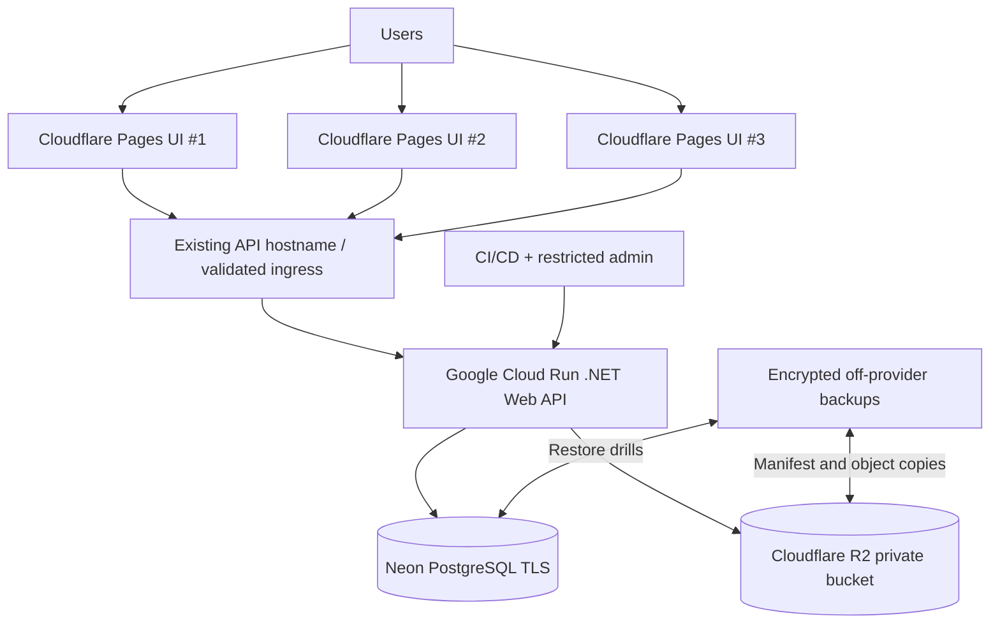
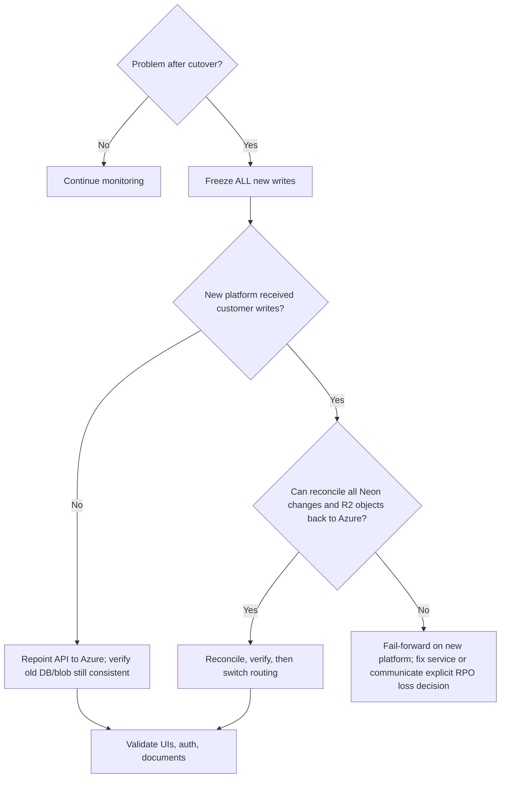

# VexorionERP — Azure Exit Migration Plan

**Version:** 1.0 | **Date:** 2026-10-20 | **Status:** Implementation proposal; owner approval required before cutover  
**Audience:** Product owner, engineering, Codex coding agent  
**Priority:** Data integrity and recoverability > near-zero infrastructure cost.

## 0. Confirmed context and non-goals

**Confirmed:** VexorionERP has pilot users with real business data. Three frontend UIs are already hosted on **Cloudflare Pages**. Backend is **ASP.NET Core Web API**; database **PostgreSQL**; documents currently live in **Azure Blob Storage**. All work is HTTP request-driven; there are **no background workers**. Migration scope covers **only API, database, and document storage**. All three Cloudflare Pages sites remain in place.

**Do not assume:** exact .NET version, EF/Npgsql version, PostgreSQL version/extensions, auth implementation, current API DNS, blob count/size, RPO/RTO, or current code repository structure. Codex must inspect these first. Never display secrets or production customer records in logs.

**Non-goals:** rewrite all frontends; migrate PostgreSQL to a different engine; refactor unrelated business logic; add microservices; silently replace production secrets; shut down Azure before successful verification.

## 1. Hosting decision and cost comparison

### Recommended option A (pilot): Google Cloud Run + Neon PostgreSQL + Cloudflare R2

- **API:** Dockerized existing .NET Web API deployed to Cloud Run, *request-based billing, minimum instances = 0*, initially max instances = 1–2 (tune following DB pool/load testing). A cold start is acceptable if measured and explained to pilot users. Limit concurrent requests to protect DB. Container must listen on injected `PORT` and bind `0.0.0.0`.
- **Database:** Neon managed PostgreSQL. Use TLS-required connection, explicitly test the **pooled endpoint** for app usage and **direct connection** for EF migrations, if provider advises. Check extensions, PostgreSQL versions, schema, timezone, and collations. Avoid automatic migration on every instance startup.
- **Documents:** private Cloudflare R2 **Standard** bucket, accessed through AWS S3-compatible .NET SDK. Preserve existing logical document IDs and object paths or maintain explicit mapping. Server-side authorization precedes every download/upload URL issuance.
- **Frontend:** three existing Cloudflare Pages deployments unchanged apart from API endpoint configuration *only if* necessary. Preserve CORS allowlist and auth flow.
- **DNS:** For first staging deploy use a standard `*.run.app` HTTPS URL. For production `api.vexorionerp.com`, evaluate a tested routing method **before cutover**: Google Cloud recommends an external Application Load Balancer for Cloud Run custom domains (may have meaningful fixed cost), while direct Cloud Run domain mapping is preview/not recommended for production. Compare Firebase Hosting proxy, a Cloudflare Worker reverse proxy if functionally/security appropriate, or retaining a tested existing ingress. Do not assume a Cloudflare DNS CNAME alone maps a custom hostname to `run.app`.

### Alternative option B: Oracle Always Free A1 VM + Neon + R2

- Host only the API in a `linux/arm64` Docker container behind Caddy/Nginx, monitoring + systemd restart policy.
- **Advantages:** Can avoid Cloud Run cold starts; no always-on API compute charge within Always Free limits; conventional custom domain/TLS possible without GCP load balancer.
- **Risks:** capacity not assured; ARM dependencies need validation; OS upgrades/firewall/patching/monitoring become your responsibility; VM availability/idle reclamation and operational overhead; no automatic scaling.
- **Backup alternative:** one VM also hosting PostgreSQL is technically possible, but **not preferred for real pilot data** due to single failure domain, disk constraints, and manual backups.

### Costs: scenario-based, not guaranteed bills

| Component | Cloud Run stack | Oracle stack | Planning notes |
|---|---|---|---|
| API compute | Potentially $0/month in free allowance | Potentially $0 on Always Free A1 | Cloud Run can bill compute, requests, outbound transfer, logging, builds/registry; OCI over-quota resources bill and free capacity may be unavailable. |
| PostgreSQL | Neon Free *if under limits* | Neon Free *if under limits* | As of Oct 2026 Neon Free: **1 GB storage/project**; verify current CU-hours, transfer and restore limits in dashboard before choosing. For real data upgrade promptly when close to limits. |
| Documents | R2 Standard 10 GB-month free, 1M Class A and 10M Class B operations/month | Same | Standard storage above free allowance: $0.015 per GB-month; storage/operation rounding and region/fees apply. No egress fee from R2. |
| Custom API domain | May cost money; routing choice pending | Usually reverse proxy + certificate | **Do not count custom-domain ingress as $0 without verification.** |
| Backups | Independent off-provider backups likely $ | Same | Database restore testing and immutable/off-site copies are mandatory. |
| Three Pages UIs | Unchanged | Unchanged | Existing Cloudflare Pages costs unaffected. |

**Budget targets:** target ~$0 for low-volume experimentation, but reserve a small recurring contingency (e.g. $5–20/month) for backup storage, DNS ingress or database upgrade. This is a proposed budgeting buffer, not a price quote. Configure Google Cloud billing budgets and anomaly alerts; alerts are **not hard spending caps**. Prefer providers/quotas with explicit service limits and inspect billing daily after cutover.

**Choice:** prototype A first. If custom-domain ingress costs or cold-start requirements make A unattractive, pilot B. Do not migrate production until the winning architecture passes the gates below.

## 2. Logical architecture



Keep secrets in a managed secret store; production database and document buckets are *never* directly public. API endpoints still require application authentication/authorization even if Cloud Run ingress is publicly callable.

## 3. Discovery checklist — must complete before writing migrations

Codex shall produce `docs/migration/inventory.md` with:

- [ ] Determine .NET version, solution/project paths, current build command, dependency/native-library constraints, Dockerfile presence, health endpoints.
- [ ] Map current Azure App Service/Container configuration, environment values **by key only**, certificates, auth callback URLs, actual API host, deployment workflow.
- [ ] Enumerate *all three* Cloudflare Pages frontends, their origins, API base URLs, login and file flows. Avoid modifications not needed for migration.
- [ ] Inspect EF Core provider (Npgsql), migrations, SQL features, stored procedures, extensions, jobs/triggers, sequences, PostgreSQL version.
- [ ] Assess PostgreSQL size (database and largest tables), user/roles, indexes, extensions, active writes, expected concurrency; verify Neon fits or budget paid tier.
- [ ] Inventory Azure storage accounts, containers, number of blobs, total bytes, access tier, filenames/content types, object metadata, checksums, versioning, SAS URL usage, and whether document paths are stored in DB.
- [ ] Determine max request and upload size, downloads, streaming behavior, virus scanning, retention/delete compliance, PII sensitivity, data residency expectations.
- [ ] Determine background `IHostedService`, timers, queue consumers, or startup jobs; user states none, but verify code.
- [ ] Record current SLO, estimated pilot traffic, tolerable downtime, **RPO** and **RTO**, estimated monthly Azure spend.
- [ ] Record exact encryption/signing/auth strategies and whether key rotation would log all users out.
- [ ] Choose a *read-only test dataset* or approved scrubbed snapshot, without copying real user data into uncontrolled development systems.

**Stop gate:** No infrastructure decision finalized until actual DB and blob volumes, ingress requirements and data access constraints are known.

## 4. Repository plan (adapt to actual structure)

```text
/docs/migration/
  VEXORIONERP_AZURE_MIGRATION_PLAN.md
  inventory.md
  decision-record.md
  test-matrix.md
  cutover-runbook.md
  rollback-runbook.md
  evidence/                 # sanitized logs and checksums, no secrets
/src/...                     # existing code kept
/tests/...                   # existing tests extended
/infrastructure/
  cloudrun/                  # configuration templates (no credentials)
  oracle/                    # alternative, optional
/scripts/migration/
  pg_backup.sh               # safeguarded template; no embedded secrets
  pg_restore_staging.sh
  blob_inventory.py          # only if existing tools insufficient
  blob_verify.py
  smoke_test.sh
```

All scripts must support `--dry-run` or read-only checks where applicable, identify environment explicitly, and fail safely. Production write actions require human review/approval.

## 5. .NET API: implementation requirements

### 5.1 Containerize without rewriting

- Multi-stage Docker build: official .NET SDK build stage and matching ASP.NET runtime stage, pin versions; use non-root runtime user where possible.
- Restore/build/publish with existing project structure; don't embed secrets or production config in image.
- Bind to Cloud Run `PORT` with `ASPNETCORE_URLS=http://0.0.0.0:${PORT:-8080}` for the container command or entrypoint; verify shell expansion and use an entrypoint script if necessary.
- Readiness: `GET /health/live` checks process, `GET /health/ready` checks critical dependencies with timeouts but no sensitive payload. Avoid hitting DB for every liveness probe.
- Ensure stateless sessions, no reliance on local durable files, no assumed in-memory cache persistence, configured forwarded headers only from trusted ingress.
- Restrict API CORS to **exact** production/staging UI origins; credentials only if required by actual auth design.
- Confirm JWT authority/audience, refresh token handling, cookies `Secure`/`SameSite`/domain and OAuth redirect URI against real domain. Never use `AllowAnyOrigin()` with credentials.
- Add request IDs, structured metrics, meaningful exception handling and timeouts. Redact tokens, PII, connection strings, storage keys, document names from logs.
- Keep API backward-compatible for the three existing UIs; publish OpenAPI/Swagger in staging or restrict it in production as needed.

### 5.2 Database connections

- Config via `ConnectionStrings__Default` from secret manager; TLS enabled with proper validation. Never use `Trust Server Certificate=true` merely to bypass failures.
- Tune Npgsql pooling and max Cloud Run instances: `total potential connections ≈ maxInstances × poolMax + migration/admin connections`; keep below actual Neon limit.
- Handle DB wakeup/cold first connection with bounded timeout/retry on **transient errors only**; do not automatically repeat non-idempotent POST operations.
- Use separate migration deploy step and separate privileged DB credential; runtime application user should not be schema owner if practical.
- Validate long-running HTTP requests and bulk exports within Cloud Run request timeout; for long tasks use a later redesign rather than hidden background work.

### 5.3 Document storage abstraction

```csharp
public interface IDocumentStorage
{
    Task UploadAsync(string key, Stream data, string contentType,
        CancellationToken cancellationToken = default);
    Task<Stream> OpenReadAsync(string key,
        CancellationToken cancellationToken = default);
    Task DeleteAsync(string key,
        CancellationToken cancellationToken = default);
    Task<bool> ExistsAsync(string key,
        CancellationToken cancellationToken = default);
}
```

Implement `AzureBlobDocumentStorage` (existing adapter) and `R2DocumentStorage` (`AWSSDK.S3`). Select provider via `Storage__Provider=Azure|R2`, allowing staged migration and documented read-fallback if genuinely needed. Do not put the provider implementation in controllers. Maintain tenant-scoped authorization at the API, safe object keys, size/type restrictions, anti-path-traversal validation, quota checks and upload scanning policies.

R2 endpoint `https://<ACCOUNT_ID>.r2.cloudflarestorage.com`, region `auto`, private Standard bucket, least-privilege bucket-scoped token. Test SDK path-style configuration and signature behavior. Use short-lived presigned URLs only after authorization; assess existing frontend upload flow before changing contracts. For direct-browser uploads define exact R2 CORS origins/methods/headers and validate object upload completion server-side before committing document metadata. Treat ETag as **not a universal content hash**, especially for multipart uploads.

### 5.4 Staged integration configuration

```text
ASPNETCORE_ENVIRONMENT=Staging
ASPNETCORE_URLS=http://0.0.0.0:8080
ConnectionStrings__Default=<secret from provider, never commit>
Storage__Provider=R2
Storage__R2__AccountId=<nonsecret>
Storage__R2__BucketName=<nonsecret>
Storage__R2__AccessKey=<secret>
Storage__R2__SecretKey=<secret>
AllowedOrigins__0=https://<actual-ui-1>
AllowedOrigins__1=https://<actual-ui-2>
AllowedOrigins__2=https://<actual-ui-3>
```

Use secret references and service identity for sensitive values. Keep separate staging and production credentials/buckets/databases.

## 6. Database migration: PostgreSQL Azure → Neon

### 6.1 Rehearsal

1. Confirm source/target PostgreSQL versions and extensions; choose appropriate `pg_dump`/`pg_restore` client version (at least compatible with source server); verify Neon supports required features.
2. Create destination database and least-privilege users. Restrict who can access backups.
3. Acquire consistent logical snapshot; restore **into staging only** first.
4. Example template; never paste real credentials in terminal commands or chat:

```bash
# Securely provide SOURCE_DB_URL and TARGET_DB_URL via your secret mechanism.
# No 'set -x'; protect output directory; prevent accidental production restore.
umask 077
pg_dump --dbname="$SOURCE_DB_URL" --format=custom --no-owner --no-acl \
  --file="backup_vexorion_$(date -u +%Y%m%dT%H%M%SZ).dump"
# Restore only to an EMPTY, verified staging target; confirm host and DB name.
pg_restore --dbname="$TARGET_STAGING_DB_URL" --no-owner --no-acl \
  --exit-on-error --single-transaction backup_file.dump
```

5. Verify schemas, table row counts, sequences after restore, indexes, unique constraints, foreign keys, extension-dependent operations, and app read/write integration tests.
6. Test the database under realistic access patterns and expected startup concurrency; measure P50/P95 API response times.
7. Document exact restore duration, backup size, drift, role/permission issues and time to recover.

**Caution:** These commands are templates, not guaranteed compatible with every managed Postgres permission setup. Examine role ownership, extensions and sequence privileges. For large databases choose an appropriate non-single-transaction restore and restore strategy. `pg_dump` captures a consistent snapshot, but not subsequent writes.

### 6.2 Production cutover strategy: maintenance-window snapshot

Use a short **maintenance window** (simplest for pilot). Notify users and stop all writes across all three UIs, direct API integrations, and admin scripts. A UI maintenance banner alone is not sufficient: enforce read-only/write-block at API/ingress too.

1. Set and verify write freeze in old production API. Record cutoff timestamp, database transaction/wal position if relevant, and last file upload ID.
2. Complete any in-flight requests; confirm no ongoing writes/uploads.
3. Produce fresh encrypted PostgreSQL backup; export from same freeze boundary; record SHA-256 of encrypted archive and store off-provider.
4. Restore to production Neon database using verified procedure. Verify counts, domain critical aggregates and application queries, sequences, roles, and constraints.
5. Switch storage records only when the copied R2 objects referenced in PostgreSQL have been verified.
6. Smoke test new Cloud Run staging/live target using admin test user and test records **while write freeze is still enforced**.
7. Route API hostname to new service, release write freeze **only after** signoff and functional tests.
8. Observe pilot usage and prevent old Azure backend from accepting writes; otherwise split-brain occurs.

If a maintenance window is unacceptable, design a separately reviewed CDC/logical replication strategy with explicit source/target consistency testing. Do **not** improvise live dual writes.

## 7. Blob migration: Azure Blob → Cloudflare R2

### 7.1 First inventory and mapping

- Enumerate all source containers and blobs, storage tier, metadata, ETag, content length, content type, logical document ID, tenant owner, retention policy.
- Determine whether DB stores Azure absolute URLs or blob paths. Prefer provider-neutral `documentId`, bucket/key mapping and storage service methods. Preserve old keys when safe.
- For each source object write a manifest: `logicalDocumentId`, `sourceContainer`, `sourceKey`, `targetBucket`, `targetKey`, `lengthBytes`, `sha256` (calculated securely when feasible), `contentType`, `lastModified`, `status`. Store manifest securely, exclude customer details from shared evidence.
- Decide how to handle soft-deleted/versioned blobs, metadata, legal hold, empty objects, large multipart uploads and duplicates.

### 7.2 Bulk copy before cutover

- Create private R2 Standard bucket with restricted token and encryption defaults.
- Use audited `rclone` transfer or a small streaming migration program. Configure retries, bounded parallelism, checksums where supported, resumable execution and logs without personal document names.
- Transfer all existing objects, preserving keys and content type/metadata where possible; record exceptions separately.
- Compare **counts, byte sizes and independently computed SHA-256 samples/full set** where feasible; do not assume cross-provider ETags match MD5.
- Check authorization and signed download flows against R2 in staging; verify office docs, PDFs, images and large files open correctly.
- Keep Azure immutable/untouched during pre-copy. Do not delete Azure blobs yet.

### 7.3 Final delta synchronization

During the coordinated **API write freeze**, copy all blobs created/modified after the prior copy, and reconcile deletions and versions. Re-run manifest verification for all DB-referenced objects before enabling new writes. A deleted source object must not be resurrected without review. If the DB and Azure blob state are inconsistent, abort cutover and reconcile manually.

### 7.4 New writes and rollback boundary

After enabling writes on the new platform, **DNS rollback alone is unsafe**: Neon/R2 will contain new records and uploads absent from Azure. Define a *cutover acceptance window* (e.g. 30–60 minutes) and a rollback operator who can freeze new writes and execute **reverse reconciliation** of database and blobs, or revert to the pre-cutover snapshot with explicitly approved loss of post-cutover writes. For real pilot data, **default to fail-forward** (fix new environment) rather than silently discard new business records. Require owner decision and notify users if RPO cannot be met.

## 8. Security baseline and compliance

- **Secrets:** Google Secret Manager (or equivalent) for DB credentials, JWT signing keys, OAuth secrets, storage keys. Use least-privilege service account and rotate after migration. Keep original auth signing material if existing sessions should survive.
- **Network:** HTTPS everywhere, PostgreSQL TLS certificate validation, R2 TLS; don't expose database to unrestricted untrusted access where configurable. Cloud Run public invocation still requires API authentication; apply rate limits and request size limits. If static outbound IP allowlisting is required, Google Cloud NAT/VPC may add fixed cost.
- **Tenant isolation:** Test per-tenant document IDs and database access, role permissions, administrative routes, and cross-tenant ID enumeration.
- **Object storage:** Bucket private; never return raw credentials or long-lived public links. Use short-lived signed URLs after access checks; ensure delete and retention policies are correct. Review file MIME spoofing, malware scanning and download content disposition.
- **Data handling:** Keep real data only in approved regions/providers; confirm privacy notice, customer agreements and cross-border transfer requirements before moving from Azure. Delete staging copies on schedule.
- **CI/CD:** Use GitHub Actions OIDC/workload identity federation where practical instead of long-lived GCP service account JSON keys; pin actions and protect deployment environments.
- **Production guards:** Require manual approval for production migrations and cutover; never execute destructive `DROP`, overwrite, bulk delete or live import automatically from a Codex prompt.
- **Observability:** Error rate, P95, container cold starts, DB connections/latency, failed uploads, storage 403s, backups and billing. Redact sensitive information.

## 9. Testing matrix (critical)

| Area | Test cases | Release gate |
|---|---|---|
| API | GET/POST/PATCH/DELETE, pagination, validation, status codes | Functional parity across all three Pages UIs |
| Auth | Login/logout, token refresh, roles, CORS, callbacks, expiring sessions | No privilege regression, no credential leak |
| Tenant access | Cross-tenant record/document access, guessed IDs | Forbidden across boundaries |
| PostgreSQL | Row counts, schema, constraints, sequences, transactions, timezone, extension usage | No missing or mismatched required records |
| Storage | Upload/download/delete, 0-byte, large file, Unicode filename, MIME, signed link expiry | All existing referenced objects accessible |
| Database ↔ storage | Simultaneous create/update/delete failures, orphan detection | No dangling document pointers in validated data |
| Load | P50/P95 for login, common CRUD, report, 10 concurrent pilot users (adjust to real load) | Within agreed pilot SLO |
| Cold start | First request after 15+ min idle | Acceptable latency/no timeout |
| Recovery | Rehearse restore into isolated environment; integrity checks | Restore within approved RTO |
| Lifecycle | Bad deployment rollback, secrets rotation, DB maintenance, region outage response | Procedures documented and exercised |
| Frontends | All three Cloudflare Pages sites with production-like API routing | No changes beyond intended endpoint if needed |

**Explicit go/no-go gate:** no production cutover until DB restore, blob verification, end-to-end tests, a rollback rehearsal and designated operator signoff pass. Record test evidence and open critical bugs in tickets.

## 10. Deployment and operations

### Cloud Run staging template

```bash
# Example only: replace placeholders with inspected actual GCP project/region/image.
gcloud run deploy vexorion-api-staging \
  --image="REGION-docker.pkg.dev/PROJECT/REPO/vexorion-api:COMMIT_SHA" \
  --region="REGION" \
  --platform=managed \
  --min-instances=0 \
  --max-instances=2 \
  --concurrency=20 \
  --memory=512Mi \
  --cpu=1 \
  --port=8080 \
  --allow-unauthenticated
```

This template is safe for **publicly reachable staging only when the API has its own correct authentication and is not linked to real production credentials**. Cloud Run IAM `--allow-unauthenticated` is often necessary for browser-driven public endpoints but does not replace app-level auth. Configure secrets separately, set staging CORS precisely, and adjust memory/concurrency after measurements. Check per-region costs and quotas; 512 MiB may be insufficient for some .NET workloads.

**Suggested release flow:** unit/integration test → container build → vulnerability scan → deploy staging revision → staging test → approval → deploy prod revision with 0% or guarded traffic where routing supports → smoke test → controlled traffic shift → monitor. DB migrations happen in reviewed release-specific step, never automatically during each container startup.

### Oracle fallback

- Provision A1 within Always Free allowances and region capacity.
- Build/publish `linux/arm64`, verify all native dependencies.
- Configure firewall: allow 443 (and 80 for ACME redirect as needed); SSH only via restricted access, keys, no password login.
- Use Caddy/Nginx; run container with non-root user and restart policy, unattended OS security updates with controlled maintenance, dedicated application user, disk/CPU alerts.
- Implement deploy/rollback with image digests and app health checks.

## 11. Cutover runbook and rollback checklist

### Before cutover — required approvals

- [ ] Pilot users notified of maintenance window and expected downtime.
- [ ] Old and new environments, DNS TTL, API URL and rollback authority documented.
- [ ] Complete encrypted, verified PostgreSQL backup stored outside source provider.
- [ ] Azure Blob complete inventory + last successful pre-copy verification.
- [ ] Independent storage backup and restore test completed.
- [ ] New API auth/CORS and all 3 UIs tested in staging.
- [ ] Domain ingress tested with actual hostname, TLS, redirects and cookies.
- [ ] Billing alarms, provider quotas, monitoring and incident contact established.
- [ ] Owner signoff for acceptable downtime, RPO/RTO and limited pilot support plan.

### Cutover (operator-controlled, no fully automated production switch)

1. Announce maintenance and **enforce backend write freeze** on old Azure environment.
2. Drain uploads and pending writes; record freeze timestamp and data high-water marks.
3. Final encrypted database dump + independent copy; final Azure Blob delta sync.
4. Restore final dump to target Neon and verify all required objects exist in R2.
5. Run read-only smoke checks and integrity queries on new API with maintenance flag still on.
6. Change API routing at verified production ingress; validate cert, DNS, auth and each frontend.
7. Owner signs off; enable writes **only on new API**; keep old API blocked.
8. Closely monitor 1 hour and again daily for a week; reconcile new DB rows/files and application errors.
9. Retain Azure unchanged for agreed rollback/retention period; delete only after formal acceptance.

### Rollback decision tree



Rollback never means merely changing DNS if new users have written data. All actions must be timed and logged in change record.

## 12. Codex implementation milestones

| ID | Work | Acceptance |
|---|---|---|
| VX-M00 | Audit repository and infra configuration; fill `inventory.md` | No guessing; unknowns flagged; no edits to prod |
| VX-M01 | Add storage abstraction with Azure adapter retained | Existing Azure behavior/test parity |
| VX-M02 | Implement R2 adapter, private access, upload/download/delete and unit tests | Staging R2 integration tests pass |
| VX-M03 | Add container build and health checks; Cloud Run staging | `/health/live` and CRUD work on staging |
| VX-M04 | Configure staged Neon connections and tested DB restore script | Staging full schema/query tests pass |
| VX-M05 | Build blob manifest and idempotent copy/verification utility | Counts/size/hash reconciliation reviewed |
| VX-M06 | Run all three UI E2E workflows against staging API | Auth, CRUD, reports and documents work |
| VX-M07 | Add operational alerts, backups, runbooks and cost dashboards | Restore drill and incident simulation pass |
| VX-M08 | Human-reviewed production cutover | Signed checklist; write freeze; zero missing docs |
| VX-M09 | Post-cutover monitoring and Azure decommission plan | Stable monitoring and approved retention |

**Cross-cutting definition of done:** tests green, no secrets committed, no production data in test fixtures, backward-compatible API contracts, documentation updated, evidence attached, revert procedure exists.

## 13. Codex prompts

### Phase 1: audit only (paste first)

> We are migrating VexorionERP (ASP.NET Core Web API; PostgreSQL; Azure Blob Storage) from Azure to a lower-cost platform. Three frontend UIs are already on Cloudflare Pages and must remain unchanged. The app has real pilot data and no background workers. Read `docs/migration/VEXORIONERP_AZURE_MIGRATION_PLAN.md` first. Inspect repository structure, csproj dependencies, EF/Npgsql migrations, storage integration, auth/CORS, config and existing CI. Write `docs/migration/inventory.md` and a concise implementation impact report. Do NOT change code or deploy yet. Do NOT log secret values. List any unavailable infrastructure facts requiring operator input.

### Phase 2: storage and staging API

> Continue from the current git state, inspect git status/diff, and read the migration plan and inventory. Implement **VX-M01 and VX-M02 only** with tests: storage abstraction retaining Azure behavior, an S3-compatible Cloudflare R2 implementation with scoped settings and private bucket, and safe provider selection. Maintain existing API contracts and tenant authorization. Use test/mocked credentials; do not perform production transfers. Run and report relevant tests and outstanding gaps.

### Phase 3: container and database

> Continue from the current repo state. Implement **VX-M03 and VX-M04 only**: reproducible .NET container build, Cloud Run-compatible port binding and health endpoints, Neon staging connection and read-only inventory/restore scripts, tests for pooled/direct DB behavior. No production credentials or production migration actions. Explain required manual setup and estimate resources.

### Phase 4: transfer tooling and rehearsals

> Implement **VX-M05 and VX-M06 only**, after inspecting existing tooling. Create idempotent Azure-to-R2 inventory/copy verification utilities and sanitized reports, plus a complete staging E2E matrix for the three Cloudflare Pages apps. Never delete blobs. Support dry-run; write tests for failure/restart and mismatch behavior. Do not point production DNS to the new service.

### Phase 5: operational gate

> Produce **VX-M07** backups, restore testing steps, security checks, ingress cost comparison, cutover and rollback checklists with operator approval points. Do not perform a production cutover, production write freeze, production secret change, or Azure deletion without explicit instruction.

## 14. Provider references (verify again immediately before provisioning)

- Cloud Run pricing: https://cloud.google.com/run/pricing
- Cloud Run domain options: https://docs.cloud.google.com/run/docs/mapping-custom-domains
- Cloud Run deploy: https://docs.cloud.google.com/run/docs/deploying
- OCI Always Free: https://docs.oracle.com/en-us/iaas/Content/FreeTier/freetier_topic-Always_Free_Resources.htm
- Neon current pricing: https://neon.com/pricing
- Neon October 2026 storage update: https://neon.com/blog/neon-free-plan-1-gb-per-project
- R2 pricing: https://developers.cloudflare.com/r2/pricing/
- R2 .NET SDK: https://developers.cloudflare.com/r2/examples/aws/aws-sdk-net/
- R2 presigned URLs: https://developers.cloudflare.com/r2/api/s3/presigned-urls/

## 15. Open decisions requiring owner approval

1. Production API hostname and existing routing method; can it be retained without expensive ingress?
2. Actual PostgreSQL size/extensions and storage volume. Do they fit free allowances?
3. Budget threshold, acceptable cold-start latency, monitoring, RPO and RTO.
4. Data residency/privacy contractual constraints for pilot customer records and documents.
5. Whether direct browser-to-R2 upload is needed at MVP or API-proxied transfers should be retained.
6. Whether external data integrations, OAuth, email callbacks or signed Azure Blob URLs require migration.
7. Approval process and timing for downtime and production cutover.

**Final rule for Codex:** design and implement incrementally; preserve the current three frontends; make no live destructive changes or irreversible cutover decisions autonomously.
